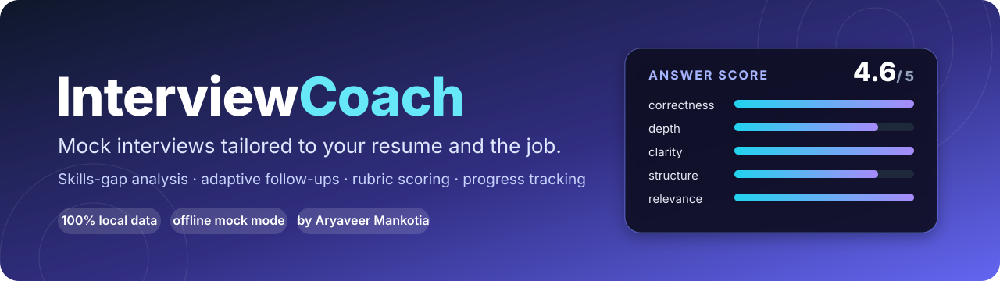
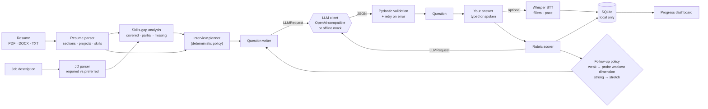
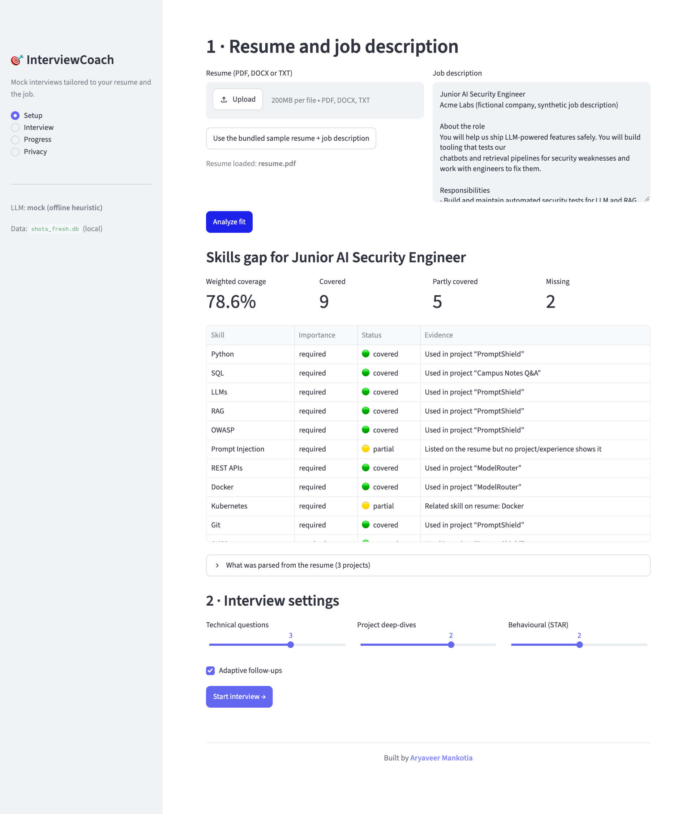
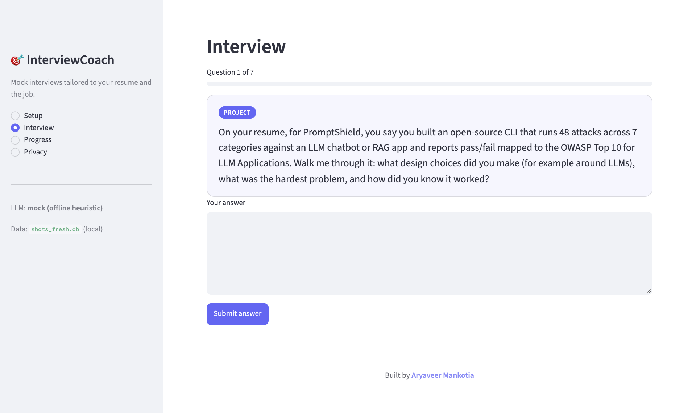
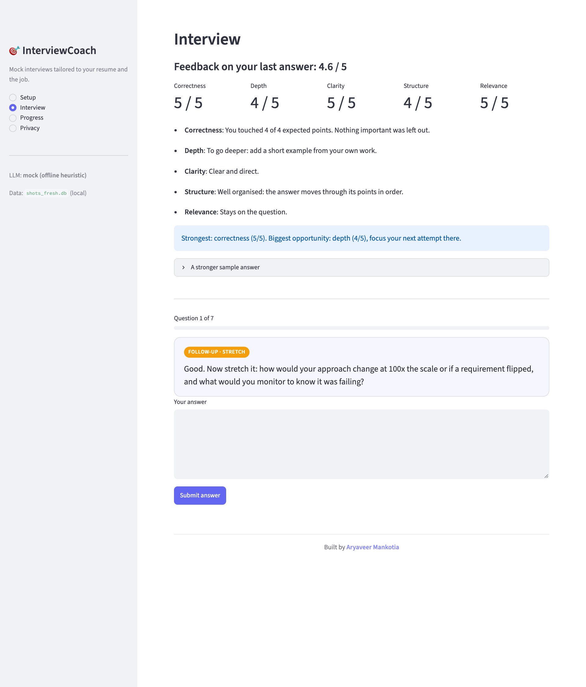
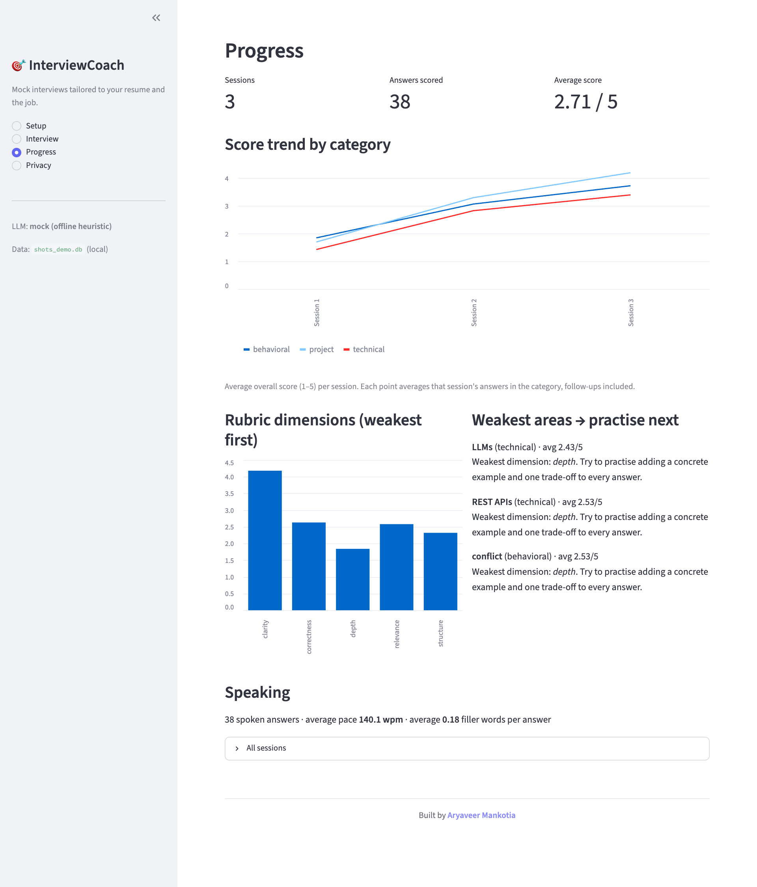
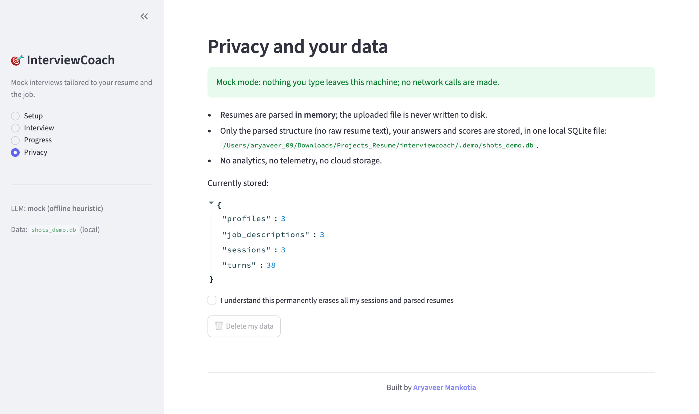

<div align="center">



<p>
  <a href="https://www.python.org/downloads/"></a>
  <a href="LICENSE"></a>
  <a href="https://github.com/Aryaveer009/interviewcoach/actions/workflows/ci.yml"></a>
  
  
  
</p>

**A mock-interview agent that reads your resume and a job description, asks questions drawn from *your own projects* and the role's requirements, scores every answer against a rubric, and tracks how you improve.**

[Quick start](#-quick-start) · [How it works](#-how-it-works) · [Screenshots](#-screenshots) · [Does the scorer work?](#-does-the-scorer-work-the-evaluation) · [Limitations](#-honest-limitations)

</div>

---

## Why I built this

I'm Aryaveer Mankotia, a CS student. Most interview-prep tools I tried hand you a generic list of questions, and the "feedback" is either nothing or a vibe. Real interviewers do something different: they open your resume, pick a project, and ask *"why did you do it that way?"*, then follow up on whatever you were vague about.

InterviewCoach tries to do that. It parses a resume and a job description, works out which requirements the resume covers, partly covers or misses, and then interviews you on exactly that: technical questions on the skills the role cares about, deep-dives into your own projects, and behavioural (STAR) questions. Each answer is scored on five rubric dimensions with specific feedback and a stronger sample answer, and every session is saved locally so you can see where you are actually weak.

I also wanted it to be *honest engineering*, not a demo. So the whole thing runs offline with a deterministic mock mode, every LLM output is validated by Pydantic, the scorer is evaluated on a hand-written answer set (including where it fails), and every number in this README comes from a real run.

## What you get

- **Resume + JD parsing** (PDF, DOCX, TXT) and a **skills-gap analysis**: each JD requirement is marked 🟢 covered, 🟡 partly covered or 🔴 missing, with the evidence.
- **Three question types**: technical (prioritised by what the JD mentions most, plus one probe at a gap), **project deep-dives written from your resume's own bullets**, and **behavioural / STAR**.
- **Adaptive follow-ups**: a weak answer gets a follow-up aimed at its weakest rubric dimension; a strong answer gets a "stretch" follow-up on scale and trade-offs.
- **Rubric scoring**: correctness, depth, clarity, structure and relevance, each 1–5, with feedback and a sample answer, returned as JSON and **validated by Pydantic** (invalid output is shown its error and retried).
- **Progress dashboard**: score trend per category, weakest rubric dimensions, weakest topics with practice suggestions.
- **Voice mode (optional)**: Whisper speech-to-text (API or local `faster-whisper`), filler-word counter and speaking-pace feedback.
- **Privacy**: runs fully offline in mock mode; data lives in one local SQLite file; a **Delete my data** button wipes it.
- **Mock LLM mode** so the app, the tests and CI need no API key and no network.

## 🧭 How it works



**The key design decision:** the *agent policy* (what to ask about, when to follow up, what kind of follow-up) is plain, deterministic Python. The LLM only does two jobs, phrasing questions and judging answers, and both go through one tiny interface (`LLMClient.complete`). That makes the agent testable offline, easy to explain, and provider-agnostic.

<details>
<summary><b>The skills-gap rules</b></summary>

| Status | Rule |
|---|---|
| 🟢 **covered** | The skill (or one that implies it, e.g. PostgreSQL → SQL) appears in a **project or experience entry**, so there is evidence of *using* it. |
| 🟡 **partial** | It is only *listed* in the Skills section with no project evidence, **or** the resume has a related skill from the same family (JD wants Kubernetes, resume has Docker). |
| 🔴 **missing** | Neither. |

Coverage % weights required skills 2× and preferred 1×, with partial counting half. Skills come from a hand-written taxonomy of 74 skills with aliases (`skills.py`); matching is lexical with word boundaries so `java` never matches `javascript`.
</details>

<details>
<summary><b>The rubric</b></summary>

| Dimension | 1 | 3 | 5 |
|---|---|---|---|
| correctness | wrong / no answer | partly right, gaps | accurate and complete |
| depth | surface statement | some detail | specifics, trade-offs, example |
| clarity | confusing, hedging | understandable | concise, unambiguous |
| structure | disorganised | some order | clear flow (full STAR for behavioural) |
| relevance | off-topic | partly on topic | fully addresses the question |

The overall score is the mean of the five. These anchors are also the system prompt sent to a live LLM judge (`prompts.py`).
</details>

## 📸 Screenshots

All screenshots are real captures of the running app (Chrome driven by Playwright, `scripts/take_screenshots.py`), using the **bundled sample resume and a synthetic job description**, in **offline mock mode** (so scoring is the heuristic described below, not an LLM).

<table>
<tr>
<td width="50%"><b>1 · Skills-gap analysis</b><br></td>
<td width="50%"><b>2 · A question drawn from the resume</b><br></td>
</tr>
<tr>
<td width="50%"><b>3 · Rubric feedback and an adaptive follow-up</b><br></td>
<td width="50%"><b>4 · Progress dashboard</b><br></td>
</tr>
</table>

<div align="center"><b>5 · Privacy page with the "Delete my data" button</b><br></div>

### The sample inputs

[`src/interviewcoach/sample_data/`](src/interviewcoach/sample_data) holds a sample resume (as PDF, DOCX and TXT) and a synthetic job description for a fictional "Acme Labs". The resume's skills and the **PromptShield** and **ModelRouter** projects are real work of mine; the third project and the internship bullets are placeholders so the demo has something to ask about, and a few lines of the resume are illustrative. Against that JD the gap analysis gives:

| Covered | Partly covered | Missing | Weighted coverage |
|:-:|:-:|:-:|:-:|
| 9 | 5 | 2 | 78.6% |

### A demo run

`interviewcoach demo` runs three scripted sessions on the sample ([`examples/demo_answers.json`](examples/demo_answers.json)), and the full transcript with per-answer scores and feedback is in [`docs/demo_session.md`](docs/demo_session.md).

| Session | Answers scored | Overall | Project | Technical | Behavioural |
|---|:-:|:-:|:-:|:-:|:-:|
| 1 (deliberately vague answers) | 14 | 1.63 | 1.70 | 1.43 | 1.85 |
| 2 (mixed answers) | 13 | 3.03 | 3.30 | 2.83 | 3.07 |
| 3 (strong answers) | 11 | 3.71 | 4.20 | 3.40 | 3.73 |

> [!NOTE]
> **I wrote those answers myself** to be vague, mixed and strong. The rising scores show the pipeline and the dashboard working end to end; they are **not** evidence that the tool makes anyone better at interviews. Session length differs because follow-ups are adaptive: weak answers trigger one, mid-band answers don't.

## 📊 Does the scorer work? The evaluation

The claim worth testing is *"does the scorer rank a good answer above a mediocre one above a bad one?"*. I wrote [**30 answers**](evals) by hand: 10 questions × (good, mediocre, bad), split into a **dev set** (6 questions, used while building the scorer) and a **held-out set** (4 questions, written *after* the scorer was frozen and run exactly once; see the git history). Some mediocre answers are deliberately long and waffly and some good ones are short and precise, so "longer is better" doesn't win for free.

**Scorer under test: the offline heuristic (mock mode).** It checks coverage of the question's expected points plus surface features (specifics, reasoning words, hedging, structure). It is *not* an LLM.

| Split | Questions | Answers | Strict order good > mediocre > bad | Pairwise correct | Ties | Spearman ρ vs. label | Word-count baseline (pairwise) |
|---|:-:|:-:|:-:|:-:|:-:|:-:|:-:|
| dev | 6 | 18 | 6/6 | 18/18 | 0 | +0.93 | 17/18 |
| held-out | 4 | 12 | 3/4 | 11/12 | 0 | +0.91 | 10/12 |
| **all** | 10 | 30 | **9/10** | **29/30** | 0 | **+0.91** | 27/30 |

| Tier | Mean overall (1–5) | correctness | depth | clarity | structure | relevance |
|---|:-:|:-:|:-:|:-:|:-:|:-:|
| good | 4.24 | 5.00 | 3.20 | 5.00 | 3.30 | 4.70 |
| mediocre | 2.96 | 2.80 | 1.80 | 4.50 | 2.80 | 2.90 |
| bad | 2.26 | 1.70 | 1.60 | 4.40 | 1.80 | 1.80 |

Reproduce with `interviewcoach eval` (full per-answer table in [`evals/results.md`](evals/results.md)); a regression test pins these numbers so the README cannot silently drift.

**How to read this honestly:**

- ✅ The heuristic ranked **29 of 30** pairs correctly, including 11/12 on the held-out set.
- ⚠️ It **failed one held-out item** (REST API): the "bad" answer (2.40) outscored the "mediocre" one (2.20) because the bad answer happened to contain on-topic words like *endpoint* and *200*. I did not tune the scorer afterwards, so the miss stays in the table.
- ⚠️ The **word-count baseline gets 27/30**. The scorer's real margin over "longer = better" is **2 pairs out of 30**, which is thin. This is a small set; do not read it as proof of anything beyond "the heuristic is sane".
- ⚠️ **Adversarial check:** keyword-stuffed non-answers (a bare list of expected keywords) ranked 3rd, 3rd and 4th of 4 on their items. They scored 2.4–2.6, but the stuffing penalty is one more hand-built heuristic tested on just three examples.
- ⚠️ The held-out set is held out *from tuning*, but I wrote it, and I also wrote the scorer. It is not an independent benchmark. Most of the score is also **compressed**: good answers scored between 3.8 and 4.8 because depth and structure are hard to max lexically.
- ❓ **The live LLM judge is not evaluated.** I had no API key during development, so the `openai`-compatible scorer path is only tested with stubs (validation, retry, error handling). Set a key and run `LLM_PROVIDER=openai interviewcoach eval` to get the same table for a real model; that comparison is the interesting experiment.

## 🚀 Quick start

```bash
git clone https://github.com/Aryaveer009/interviewcoach.git
cd interviewcoach
python -m venv .venv && source .venv/bin/activate
pip install -e .

interviewcoach app        # opens the Streamlit app, offline mock mode by default
```

In the app click **Use the bundled sample resume + job description → Analyze fit → Start interview**.

```bash
interviewcoach demo --voice --transcript demo.md   # 3 scripted sessions (--voice simulates pace/filler metrics)
interviewcoach eval                                 # scorer evaluation table
pip install -e ".[dev]" && pytest                   # 82 tests, no network or key needed
```

### Use a real LLM

```bash
cp .env.example .env     # then set:
# LLM_PROVIDER=openai
# LLM_API_KEY=sk-...
# LLM_MODEL=gpt-4o-mini
# LLM_BASE_URL=            # optional: Groq / Together / Ollama (http://localhost:11434/v1) / vLLM
```

Any OpenAI-compatible endpoint works through the plain `openai` SDK (no LangChain).

### Voice mode (optional)

```bash
pip install -e ".[voice]"      # only for local faster-whisper
# in .env: STT_BACKEND=api     (Whisper via your endpoint)   or   STT_BACKEND=local
```

An audio recorder appears on the interview page. Your answer is transcribed, then scored like a typed one, and you also get words-per-minute (comfortable range 120–160), a filler-word count (*um, uh, you know, I mean, sort of…*) and the trend of both on the dashboard.

### Docker

```bash
docker build -t interviewcoach .
docker run -p 8501:8501 -v interviewcoach-data:/data interviewcoach
```

## 🔒 Privacy

| | |
|---|---|
| Resume files | Parsed **in memory**; the upload is never written to disk. |
| What is stored | Parsed structure (no raw resume text), your answers, scores. One local SQLite file (`~/.interviewcoach/interviewcoach.db` by default). |
| Mock mode | **No network calls at all.** |
| Live-LLM mode | Your answers and a short resume summary **are sent to the provider you configured**. Use mock mode or a local model (Ollama) to keep everything on your machine. |
| Telemetry | None. |
| Delete my data | Privacy page → erases every row, resets IDs, uses SQLite `secure_delete` and `VACUUM`. A test checks the text is gone from the file bytes. |

## 🗂️ Project layout

```
src/interviewcoach/
  parsing.py      resume + JD → sections, projects, skills        gap.py        skills-gap analysis
  skills.py       skills taxonomy + matcher                       interview.py  planner, question writer, session, follow-up policy
  models.py       Pydantic models (RubricScore, Question, ...)    scoring.py    RubricScorer (validate + retry)
  llm/            base interface · OpenAI-compatible client · mock + heuristic scorer · structured-output helper
  db.py           SQLite store + delete_all                       progress.py   dashboard maths
  voice/          Whisper backends · filler + pace metrics        evaluation.py scorer evaluation harness
  ui/app.py       Streamlit app                                   cli.py        app | demo | eval
evals/            hand-written answer sets (dev, held-out) + results
tests/            82 tests: parsing, gap, rubric schema, DB, agent, voice, config, eval, UI
```

## ⚠️ Honest limitations

- **Mock mode is a heuristic, not intelligence.** Its "sample answers" are assembled from the expected points and its feedback is templated. For genuinely useful feedback, use a live model.
- **Rule-based parsing** handles conventional single-column resumes (it was checked on the bundled sample in PDF, DOCX and TXT form only). Multi-column or heavily designed layouts will degrade; scanned PDFs are rejected (no OCR).
- **The skills taxonomy is hand-written** (74 skills); anything outside it is invisible to the gap analysis.
- **Voice mode:** the metrics (fillers, pace, WAV duration) are unit-tested, and the Whisper API client is tested against a stub. **Real microphone → Whisper/faster-whisper transcription has not been run end to end** by me.
- **Docker:** a `Dockerfile` and a CI job that builds it and checks the health endpoint are included. I had no Docker on my development machine, so I have not run the image locally.
- Small evaluation set (see above). Treat the table as a sanity check.

## 🧪 Tests and CI

82 tests (97% line coverage on the offline suite), `ruff`, and `mypy` run on Python 3.11 and 3.12 in [GitHub Actions](.github/workflows/ci.yml), which also runs the scorer evaluation, the demo, and a Docker build + health check.

---

<div align="center">

**Built by [Aryaveer Mankotia](https://github.com/Aryaveer009)**

[MIT licensed](LICENSE)

</div>
